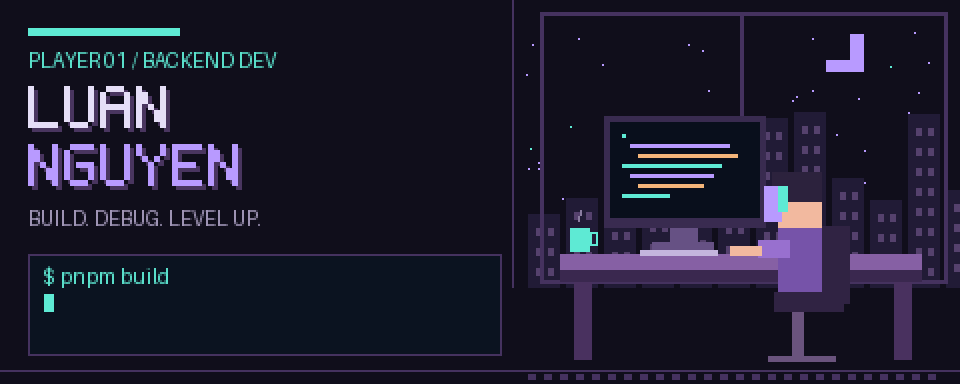

<div align="center">



# Hey, I'm Luan 👾

**Backend developer · IT student · Building one commit at a time**

<a href="https://github.com/Luannguyenduiga"></a>
<a href="mailto:nguyenthanhluan13022006@gmail.com"></a>

`[ VIETNAM / UTC+7 ]` &nbsp; `[ BACKEND MAIN ]` &nbsp; `[ ALWAYS LEARNING ]`

</div>

---

### 🕹️ PLAYER INFO

I'm **Luan Nguyen**, an Information Technology student at **HCMUNRE** in Ho Chi Minh City, Vietnam. I enjoy turning ideas into APIs, designing databases, and figuring out why that one query is slow.

- 🔧 Building backend systems with **Node.js, NestJS, and Fastify**.
- 🗃️ Working with **PostgreSQL, MongoDB, and Redis**.
- 🌱 Leveling up in **system design, design pattern, database optimization, and asynchronous processing**.
- 🤝 Happy to connect over backend development, learning, and interesting projects.

```typescript
const luan = {
  class: "Backend Developer",
  mainQuest: "Build reliable systems. Keep learning.",
  inventory: ["TypeScript", "Node.js", "Java", "SQL"],
  currentBuild: ["REST APIs", "Databases", "Background jobs"],
};
```

### ⚔️ TECH INVENTORY

**Languages**


**Backend & data**


`Fastify` · `REST APIs` · `JWT / OAuth 2.0` · `BullMQ` · `WebSockets`

**Tools**


### 🚀 QUEST LOG

| Quest | What I worked on | Loadout |
| :--- | :--- | :--- |
| **[CodeQuest](https://github.com/Luannguyenduiga/CodeQuest)** | Personalized DSA learning platform; APIs, AI learning roadmaps, and queued code execution. | NestJS · MongoDB · Redis · BullMQ |
| **[Gender Insights](https://github.com/Luannguyenduiga/GenderInsights)** | Gender education platform; authentication, real-time features, database tuning, and caching. | Fastify · PostgreSQL · WebSockets |

### 📊 SAVE FILE / GITHUB STATS

<div align="center">

<a href="https://github.com/Luannguyenduiga?tab=repositories">
  
</a>
<a href="https://github.com/Luannguyenduiga?tab=repositories">
  
</a>


<sub>Live cards show public GitHub activity. Language usage describes repositories, not proficiency.</sub>

</div>

---

<div align="center">

**Have a quest in mind? Let's build it.**

[Send a message](mailto:nguyenthanhluan13022006@gmail.com) · [Explore my repos](https://github.com/Luannguyenduiga?tab=repositories)

`while (curious) { learn(); build(); repeat(); }`

<sub>INSERT COFFEE ▪ SAVE PROGRESS ▪ NEXT LEVEL</sub>

</div>
